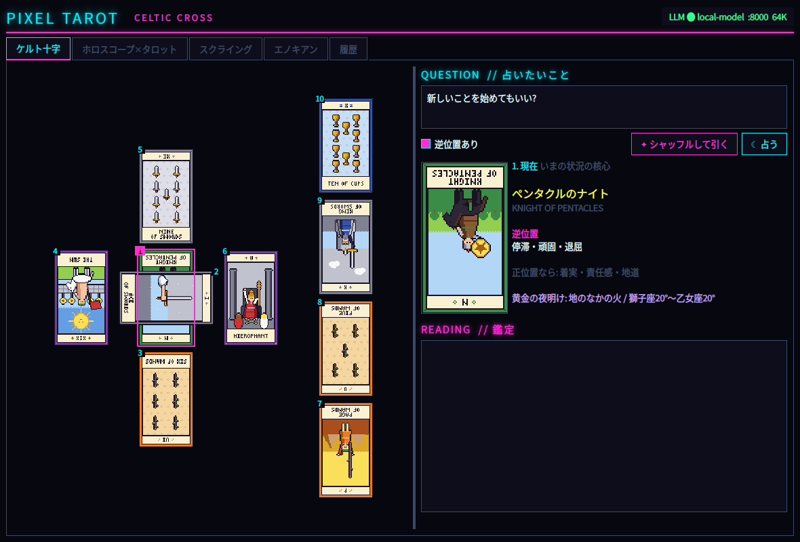
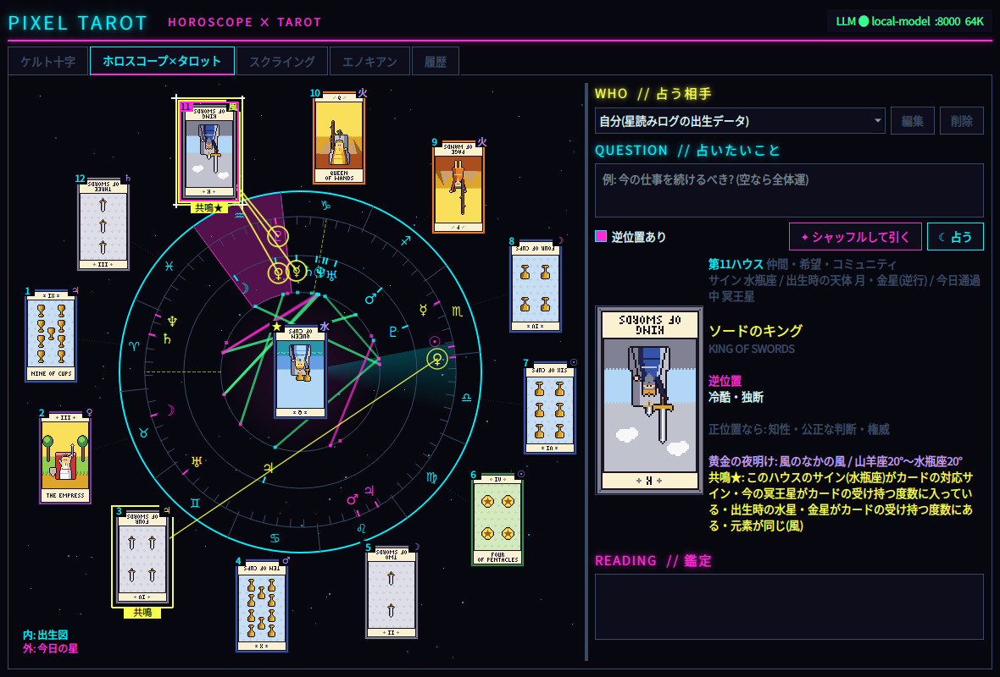
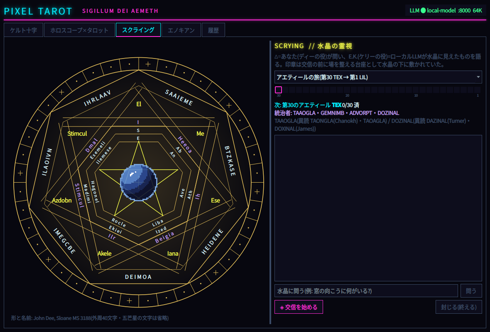
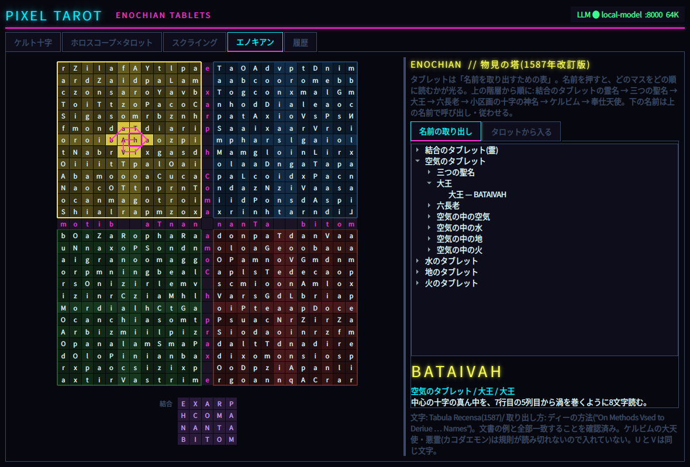
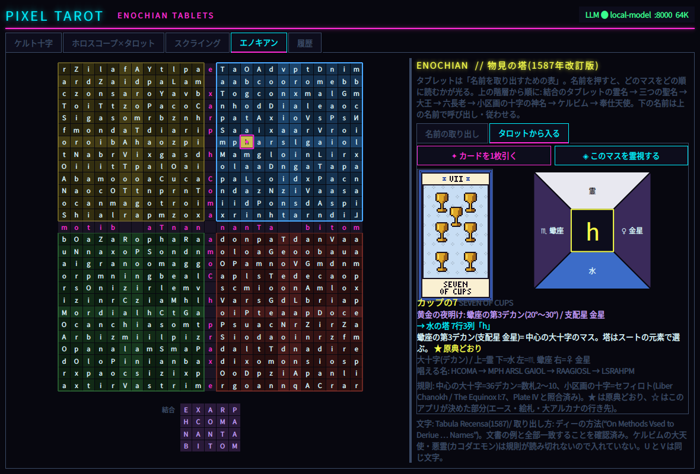

# PIXEL TAROT

自作のピクセルアート・タロット 78 枚で占う、ローカル LLM のタロットアプリ。
ケルト十字、ホロスコープ✕タロット(黄金の夜明け団の対応と「共鳴」)、ジョン・ディーの Sigillum Dei Aemeth を使った水晶の霊視、
エノキアン・タブレット(1587 年改訂版)の名前の取り出し方・30 のアエティールの旅・タロットから入るマスの霊視まで入っている。


## 起動

```bash
pip install -r requirements.txt
./run.sh          # または python app.py
```

- カードの絵は初回起動時に `tarot.py` が作る(`out/cards/`)。`python tarot.py` で作り直せる。
- 鑑定文は**ローカル LLM**が書く。動いている `llama-server` を自動で見つけてつなぐ(`/proc` のコマンドラインからポートとモデルを読み、`/v1/models` で準備できているか確かめる。複数あれば :8000 優先)。
  ほかの OpenAI 互換エンドポイントを使うなら `PIXEL_TAROT_LLM_URL=http://host:port/v1 ./run.sh`。LLM が無いときはカードのキーワードを並べるだけで占える。
- `run.sh` はネイティブ Wayland(`QT_QPA_PLATFORM=wayland` / `QT_IM_MODULE=wayland`)で起動する。pip 版 PyQt6 はシステムの fcitx プラグインを読めないので、日本語入力は Wayland の text-input を使う。
- フォントは [DotGothic16](https://fonts.google.com/specimen/DotGothic16) があれば使う(無ければ普通のフォント)。

## タブ

### ケルト十字



10 枚(ウェイト式の並び)。配る・めくる演出つきで、大アルカナが出ると光る。カードを押すと位置の意味・キーワード・黄金の夜明け団の対応が出る。

### ホロスコープ✕タロット



出生図の 12 ハウスに 1 枚ずつ + 中央に 1 枚。星図は [HOSHIYOMI LOG](https://github.com/muuchan0279/hoshiyomi-log) のものを移植していて、天体計算と出生データも HOSHIYOMI LOG を借りる(下の「HOSHIYOMI LOG との連携」)。

- **共鳴**:カードの対応する星や星座が実際の星図と重なると光る。対応星が今そのハウスを通過中、今の天体がカードの受け持つ度数に入っている、ハウスのサインが対応サインと同じ、など。4 点で「共鳴」、6 点で「共鳴★」(ランダムに 13 枚引くと、共鳴は平均 1.2 枚、共鳴★は 3 回に 1 回ほど)。
- **占う相手**:自分(HOSHIYOMI LOG の出生データ)のほか、ほかの人の出生データを登録して占える。地名検索はせず、主な都市の一覧か緯度経度の手入力。

### スクライング(Sigillum Dei Aemeth)



ディー(問う人)とケリー(水晶を覗く人)の交信を再現する。印章は本来、霊視の前に場を整える台座として水晶の下に敷かれていた。「交信を始める」で印章が外から内へ灯り、ローカル LLM が E.K. として水晶に見えたものを語る。

- 印章の形と名前は ディーの手稿(British Library Sloane MS 3188)の図から**読める範囲だけ**。外周 40 マスの文字と五芒星のまわりの文字は判読できないので入れていない。
- **アエティールの旅**:第 30 TEX から第 1 LIL へ、1 回の交信で 1 層ずつ進む。第 19 の呼びかけをその層の名で唱え、統治者の名を呼んでから霊視する。

### エノキアン



物見の塔(1587 年 ラファエルによる改訂版 = Tabula Recensa)と結合のタブレット。

- **名前の取り出し方**:名前を押すと、どのマスをどの順に読むかが 1 文字ずつ光る。三つの聖名・大王・六長老・小区画の十字の神名・ケルビム・奉仕天使(161 個)。
- **タロットから入る**:カードを 1 枚引くと対応するマスへ飛び、マスの四角錐(4 つの面の対応)を見せて、そのマスを霊視できる。



## 資料と、確かめたこと

正確さが大事な所は、原典の例や図版と照合した。照合できない所は入れていないか、画面で「このアプリが決めた部分」と分けて表示している。

| 内容 | 出典 | 確かめ方 |
|---|---|---|
| タブレットの文字・名前の取り出し方 | "On Methods Vsed to Deriue Certayne Divers Names from the Enochian Tablets"(funet occult archive) | 文書の例(三つの聖名・大王 4 人・空気の六長老・十字の神名・ケルビム・奉仕天使)と全部一致(`python enochian.py`)。別の表との 8 マスの違いは、Benjamin Rowe の資料などで全部決着 |
| マスの四角錐(大十字 = 36 デカン、小区画の十字 = セフィロト) | A. Crowley, *Liber Chanokh* = The Equinox I:7(1912)、Plate IV | 大十字 36 マスの星座と支配星を図版と照合して全部一致 |
| 30 のアエティールと 91 人の統治者・第 19 の呼びかけ | 19th Call 資料(keepsilence.org)、Benjamin Rowe の異同表 | 異同表で多数派の綴りに直し、資料が割れている名前は異読として表示 |
| Sigillum Dei Aemeth | John Dee, Sloane MS 3188(Wikimedia Commons、パブリックドメイン) | 手稿の図と配置を照合 |
| タロットの黄金の夜明け団の対応 | Book T の体系(大アルカナ = ヘブライ文字と惑星・星座・元素、数札 = デカン、絵札 = 元素の組) | |

入れていないもの:ケルビムの大天使と悪霊(カコダエモン)の名前(頭に付ける黒十字の文字の規則が読み切れない)、ケルビムのマスの四角錐の左右の面(原典が「やや複雑な規則なので省く」としている)。

## HOSHIYOMI LOG との連携

ホロスコープ✕タロットは [HOSHIYOMI LOG](https://github.com/muuchan0279/hoshiyomi-log) の `astro_core.py`(天体計算)を読み込み、出生データを `~/.hoshiyomi/hoshiyomi.db` から**読み取り専用で**読む。HOSHIYOMI LOG 側は書き換えない。

```bash
git clone https://github.com/muuchan0279/hoshiyomi-log   # このリポジトリと同じ階層に
```

置き場所は 環境変数 `PIXEL_TAROT_HOSHIYOMI` → 隣の `hoshiyomi/` → 隣の `hoshiyomi-log/` の順に探す。無ければホロスコープの星図は出ないが、カードだけで占える。

## データの置き場所

すべて手元だけ。外部には何も送らない(LLM もローカル)。

| 場所 | 中身 |
|---|---|
| `~/.pixel-tarot/history.jsonl` | 占いの履歴 |
| `~/.pixel-tarot/people.json` | 登録したほかの人の出生データ(権限 600) |
| `~/.pixel-tarot/scrying/` | 霊視の記録 |
| `~/.pixel-tarot/aethyrs.json` | アエティールの旅の進み具合 |

## ファイル

| ファイル | 役割 |
|---|---|
| `tarot.py` | 78 枚のカードと裏面を描く(PIL、64×112) |
| `cards_data.py` | カードの名前・キーワード(正位置/逆位置)・黄金の夜明け団の対応・ケルト十字とハウスの意味 |
| `enochian.py` | タブレットの文字、名前の取り出し、四角錐の規則、アエティールと統治者、第 19 の呼びかけ、自己照合 |
| `app.py` | PyQt6 GUI |
| `art/gen_icon.py` | アイコン |

## ライセンス

MIT(`LICENSE`)。カードの絵も同じ。歴史的な資料(ディーの手稿・タブレットの文字・呼びかけの本文)はパブリックドメイン。
